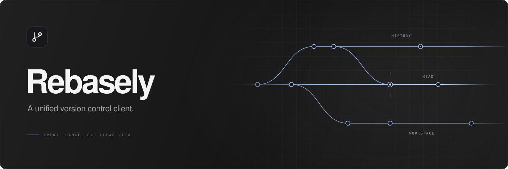

  Review changes. Follow history. Keep your work in view.  
  <a href="https://flyandnotdown.github.io/Rebasely/">Website</a> ·
  <a href="https://github.com/FlyAndNotDown/Rebasely/releases">Download</a> ·
  <a href="CONTRIBUTING.md">Contribute</a>

Rebasely brings your repositories into one desktop workspace. Move between
projects, inspect a diff, and make the next change with context.

- **Review precisely.** Inspect unified or split text diffs, compare images, and stage a file, hunk, or line.
- **Follow the work.** Explore commit graphs, branches, file history, and changelists.
- **Stay in flow.** Keep projects in tabs, with a command palette, keyboard shortcuts, and light or dark themes.

Try the [interactive feature demo](https://flyandnotdown.github.io/Rebasely/#features)
to explore example Git and Perforce workflows.

Supports Git and Perforce. Available for **macOS Apple Silicon** and **Windows x64**.

## Get started

1. [Download a release](https://github.com/FlyAndNotDown/Rebasely/releases) for your platform.
2. Install Git for Git repositories, or the Perforce CLI (`p4`) for Perforce workspaces.
3. Open or clone a Git repository, or connect an existing Perforce workspace.

To build or contribute, see the [development guide](docs/development.md).
Bug reports and ideas are welcome in
[Issues](https://github.com/FlyAndNotDown/Rebasely/issues).

## License

[MIT](LICENSE)
