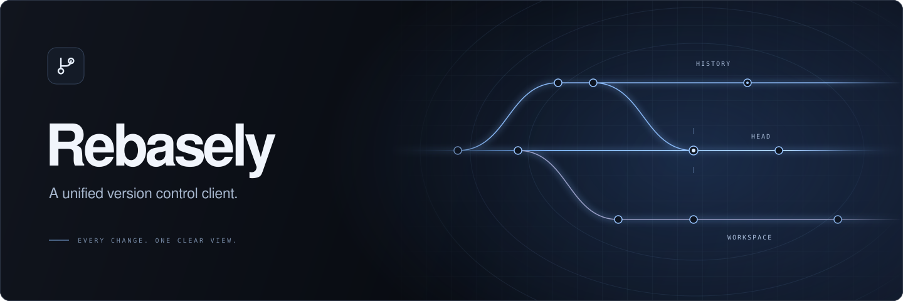

  Review changes. Follow history. Keep your work in view.  
  <a href="https://flyandnotdown.github.io/Rebasely/">Website</a> ·
  <a href="https://github.com/FlyAndNotDown/Rebasely/releases">Download</a> ·
  <a href="CONTRIBUTING.md">Contribute</a>

Rebasely brings your repositories into one desktop workspace. Move between
projects, inspect a diff, and make the next change with context.

- **Review precisely.** Compare text and images; stage a file, hunk, or line.
- **Follow the work.** Explore commit graphs, branches, file history, and changelists.
- **Stay in flow.** Keep projects in tabs, with keyboard shortcuts and light or dark themes.

Supports Git and Perforce. Built for **macOS Apple Silicon**, **Windows x64**,
and **Linux x64**. Install Git for Git repositories, or the Perforce CLI (`p4`)
for Perforce workspaces.

## Get started

[Browse releases](https://github.com/FlyAndNotDown/Rebasely/releases) or
[run from source](docs/development.md). Open a local repository or connect a
remote workspace.
Bug reports and ideas are welcome in
[Issues](https://github.com/FlyAndNotDown/Rebasely/issues).

## License

[MIT](LICENSE)
