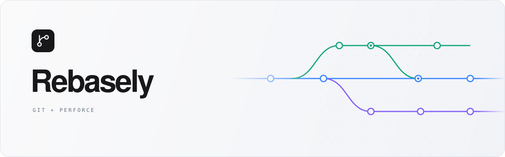

<picture>
  <source media="(prefers-color-scheme: dark)" srcset="docs/assets/hero-dark.svg">
  <source media="(prefers-color-scheme: light)" srcset="docs/assets/hero-light.svg">
  
</picture>

<p align="center">
  <strong>Git repositories. Perforce workspaces. One desktop app.</strong><br>
  Review changes, explore history, and keep your work in view.
</p>

<p align="center">
  <a href="https://v2.tauri.app/"></a>
  <a href="https://react.dev/"></a>
  <a href="https://www.rust-lang.org/"></a>
</p>

<p align="center">
  <a href="#features">Features</a> ·
  <a href="#getting-started">Getting started</a> ·
  <a href="#development">Development</a> ·
  <a href="#keyboard-shortcuts">Shortcuts</a>
</p>

---

Rebasely brings a visual working tree, commit graph, and Perforce changelists into a native window. Open several repositories in tabs, switch between Git and Perforce, and pick up where you left off on the next launch.

Repository operations run through the `git` and `p4` executables. Git hooks, LFS filters, signing, and sparse checkout follow the same behavior as the command line.

## Features

### Git, from working tree to history

| Workflow | What you can do |
| --- | --- |
| **Review changes** | Stage, unstage, or discard a file, hunk, or individual line. Select multiple files in a list or folder tree. |
| **Compare revisions** | Read inline or side-by-side diffs with syntax highlighting and whitespace filtering. Compare images side by side, with a swipe, or as an onion skin. |
| **Explore history** | Follow a commit graph, compare commits or branches, and search by author, path, content, or date. Browse files with blame and file history. |
| **Shape commits** | Commit, amend, undo, merge, rebase, cherry-pick, revert, and reset. Edit interactive rebase steps and resolve conflicts per hunk or in your merge tool. |
| **Work with remotes** | Fetch, pull, push, and publish branches. Create, check out, push, or delete tags; manage local and remote branches. |
| **Move work around** | Save and inspect stashes, create or apply patches, and manage submodules and worktrees. |

### Perforce, built around the workspace

- **Changelists in context.** Inspect pending and submitted changes; submit, shelve, unshelve, revert, or move selected files between changelists.
- **Depot and local files together.** Browse both trees, search by file or folder name, and jump between a depot path and its workspace file.
- **Revision history at hand.** Inspect file revisions and their diffs, get a chosen revision, or sync to latest.
- **A connected workspace.** Reconcile local changes, resolve pending conflicts, and choose the executable, server, user, client, and charset for your connection.

### A workspace that stays out of the way

Tabs and recent repositories survive restarts. Light, dark, and system themes follow your preference. A command palette and keyboard shortcuts keep frequent actions close. Open a repository in your terminal, a file in your editor, or a change in your configured diff tool.

Git work trees refresh when files change. Repositories keep their own progress and in-flight work, so operations in one tab do not take over another. Long-running Git operations can be cancelled, credentials return through an in-app prompt, and background fetches stay quiet when authentication is needed.

## Getting started

### Install a release

Download an installer for your platform from [GitHub Releases](https://github.com/FlyAndNotDown/Rebasely/releases). Releases use versions such as `v0.0.1` and include Windows x64, macOS Apple Silicon and Intel, and Linux x64 packages. The app can check for signed updates after installation.

Git and the optional Perforce CLI remain external dependencies. Windows installers are currently unsigned by Authenticode, and macOS builds use ad-hoc signing without Apple notarization; first-time downloads can show operating-system security prompts. Releases in a private repository require GitHub access and are unavailable to anonymous updater requests.

### Prerequisites

- **Node.js 22.13+ (22.x), 24.x, or 26+**, with npm.
- **Rust stable**, with `rustfmt` and `clippy` for development checks.
- **Git**, available on `PATH` or selected in the app's Settings.
- **Perforce CLI (`p4`)**, if you plan to use Perforce workspaces.
- Your platform's [Tauri 2 system dependencies](https://v2.tauri.app/start/prerequisites/):

| Platform | Native build dependencies |
| --- | --- |
| Windows | Microsoft C++ Build Tools and WebView2 |
| macOS | Xcode Command Line Tools |
| Linux | WebKitGTK and the development libraries listed for your distribution |

### Run the app

From the repository root:

```bash
npm ci
npm run dev
```

This starts Vite and opens the Tauri desktop app. Open an existing Git repository or clone one from the welcome screen. To use Perforce, install `p4` and connect a client workspace to your server.

### Build

```bash
npm run build
```

Tauri builds the frontend and Rust backend, then creates the platform's application bundles under `src-tauri/target/release/bundle/`.

Local builds do not require the private updater signing key. The release workflow explicitly enables signed updater artifacts for published packages.

## Development

### Checks

```bash
rustup component add rustfmt clippy
npm run check:all
```

| Command | Checks |
| --- | --- |
| `npm run check` | English source policy, TypeScript, ESLint, and frontend tests |
| `npm run check:rust` | Rust formatting, Clippy, and backend tests |
| `npm run check:all` | Both check suites |
| `npm run check:version` | Matching application versions in frontend, Tauri, and Cargo files |
| `npm run vite:build` | Frontend typecheck and production build |

The [GitHub check workflow](.github/workflows/check.yml) runs the frontend build and both check suites on Windows, macOS, and Linux when a pull request targeting `master` is opened, updated, or reopened. Ordinary branch pushes do not run it; updates pushed to an open pull request rerun checks through its `synchronize` event.

### Branches and releases

Develop on `dev` or a topic branch based on it, and update `master` through a reviewed pull request. Only the repository owner can publish through the manual [Release workflow](.github/workflows/release.yml), selecting `master` and entering an explicit `vX.Y.Z` version. Publishing requires successful native checks proving that the merged source matches the tested pull request, plus all four signed updater builds. Pushes, merges, and tags do not publish automatically.

See [the release guide](docs/releasing.md) for signing secrets, version rules, download packages, and recovery from failed builds.

### Architecture

```text
React + TypeScript
  panes · dialogs · repository state
                │
          Tauri commands
                │
          Rust backend
       ┌────────┴────────┐
     Git CLI         Perforce CLI
```

The frontend calls typed command clients; Rust owns filesystem and process work. Blocking work runs off the UI thread. Shared backend modules handle credential prompts, filesystem watching, editor and terminal integration, and persisted preferences and sessions. Native file opening and process cancellation share one platform layer.

Settings remains available when Git or Perforce is missing so you can select the executable and retry. Perforce TLS trust must be established explicitly after verifying the server fingerprint. Error messages redact URL credentials, and SSH key creation preserves existing files.

See [security boundaries and upstream dependency findings](docs/security.md) for audit commands and current limitations.

<details>
<summary><strong>Repository map</strong></summary>

| Path | Responsibility |
| --- | --- |
| `src/components/` | Git and Perforce panes, dialogs, and shared UI |
| `src/state/` | Repository state, sessions, and refresh coordination |
| `src/lib/` | Command clients, diffs, commit graphs, formatting, and shortcuts |
| `src/types/` | Frontend command and data types |
| `src-tauri/src/git/` | Git commands, parsers, and repository operations |
| `src-tauri/src/p4/` | Perforce connections, parsers, and workspace operations |
| `src-tauri/src/lib.rs` | Tauri command registration and backend integration |

</details>

For contributions, keep changes focused, add tests where behavior changes, and follow [the project guidelines](AGENTS.md). Use invented repositories and credentials in examples and test fixtures.

## Keyboard shortcuts

Use <kbd>Ctrl</kbd> on Windows and Linux, or <kbd>⌘</kbd> on macOS. The table lists shared and Git workspace shortcuts; the command palette shows the actions available in the current workspace.

| Action | Shortcut |
| --- | --- |
| Command palette | <kbd>Ctrl</kbd> + <kbd>K</kbd> or <kbd>F1</kbd> |
| Open / close repository | <kbd>Ctrl</kbd> + <kbd>O</kbd> / <kbd>W</kbd> |
| Next / previous tab | <kbd>Ctrl</kbd> + <kbd>Tab</kbd> / <kbd>Ctrl</kbd> + <kbd>Shift</kbd> + <kbd>Tab</kbd> |
| Changes / history / stash / files | <kbd>Ctrl</kbd> + <kbd>1</kbd> / <kbd>2</kbd> / <kbd>3</kbd> / <kbd>4</kbd> |
| Fetch / pull / push | <kbd>Ctrl</kbd> + <kbd>Shift</kbd> + <kbd>F</kbd> / <kbd>L</kbd> / <kbd>U</kbd> |
| New branch | <kbd>Ctrl</kbd> + <kbd>Shift</kbd> + <kbd>N</kbd> |
| Stash all / reflog | <kbd>Ctrl</kbd> + <kbd>Shift</kbd> + <kbd>S</kbd> / <kbd>R</kbd> |
| Open in editor | <kbd>Ctrl</kbd> + <kbd>E</kbd> |
| Open terminal | <kbd>Ctrl</kbd> + <kbd>`</kbd> |
| Settings | <kbd>Ctrl</kbd> + <kbd>,</kbd> |

In Perforce workspaces, <kbd>Ctrl</kbd> + <kbd>1</kbd>, <kbd>2</kbd>, and <kbd>3</kbd> open Pending, History, and Workspace. <kbd>Ctrl</kbd> + <kbd>Shift</kbd> + <kbd>F</kbd> runs Get latest.
